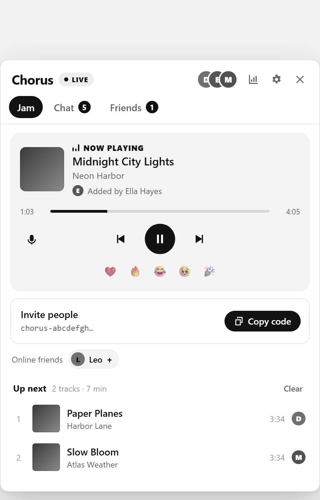
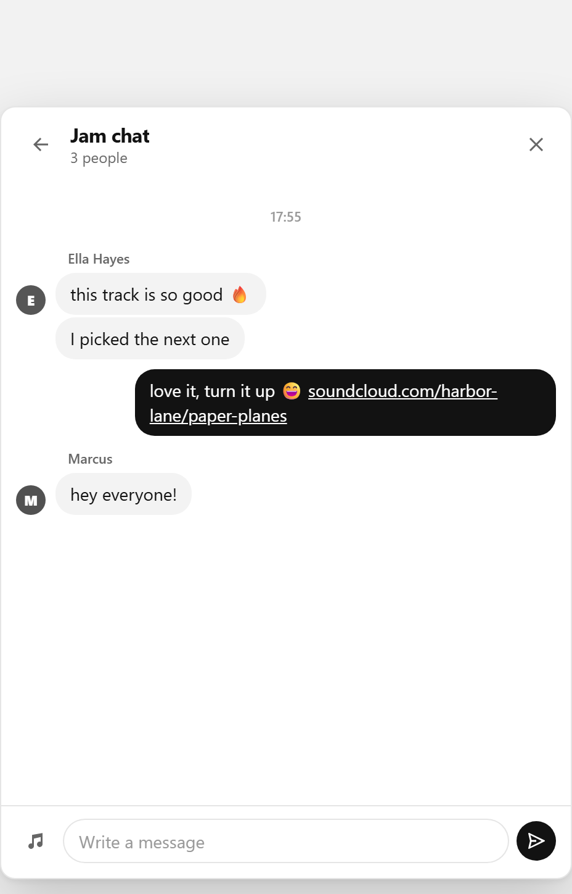
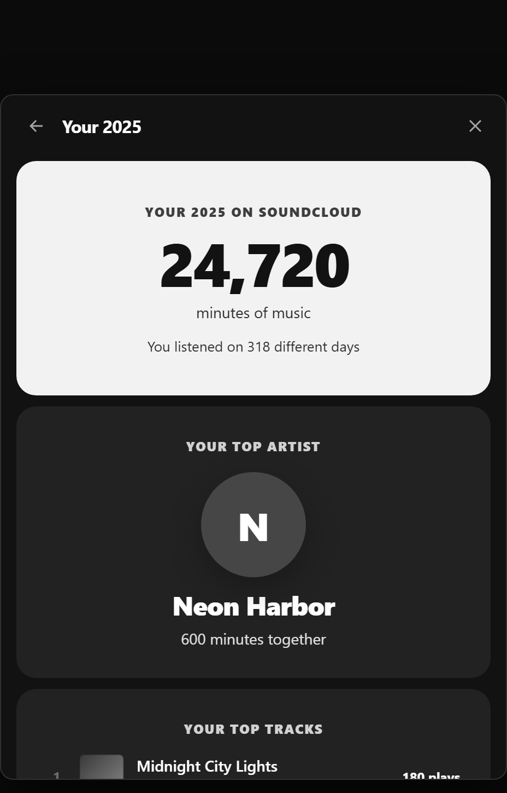

<p align="center">
  
</p>

<h1 align="center">Chorus for SoundCloud</h1>

<p align="center">
  Listen to SoundCloud together, in perfect sync.<br>
  Shared queue · friends · end-to-end encrypted chat · synced lyrics · your yearly recap
</p>

<p align="center">
  <a href="README.tr.md">Türkçe</a> ·
  <a href="#install">Install</a> ·
  <a href="#how-it-works">How it works</a> ·
  <a href="PRIVACY.md">Privacy</a> ·
  <a href="SECURITY.md">Security</a>
</p>

<p align="center">
  
  
  
</p>

## Features

**Listen together**
- **Jams.** Start a Jam, share the invite code, and everyone hears the same track at the same moment. Playback stays within a few milliseconds through clock sync and gentle speed correction.
- **Shared queue.** Add tracks or whole playlists from any `•••` menu. Drag to reorder. When the queue runs low, smart suggestions keep the music going.
- **Host controls.** The host decides what everyone else can do. By default, guests can add tracks and only the host controls playback. The host can grant **Queue** or **Control** to each person, remove people, hand over the host role, lock the Jam, or issue a new invite code.
- **Reactions.** Send ❤️ 🔥 😂 🥹 🎉 to the track that's playing.

**Friends and chat**
- **Friend codes.** Everyone has a short code like `K7QM-2XPA-9RTV`. You can add friends with their code or straight from a Jam, on any network.
- **Presence.** See which friends are online, what they're listening to, and who's in a Jam. Join with one click or invite them into yours.
- **Messages.** Chat with everyone in the Jam, or message friends directly. Everything is end-to-end encrypted.

**For you, even outside a Jam**
- **Synced lyrics.** Lyrics scroll line by line with the track. Click a line to jump to it. Lyrics come from [LRCLIB](https://lrclib.net).
- **Stats.** See your top tracks, artists and genres, total minutes, and when you listen, for the last 30 days, this year or all time. Stats are stored only on your device. You can let friends see a summary.
- **Yearly recap.** Once the year is over, your recap of minutes, top artist, top tracks and vibe is ready to open and share.
- **Sleep timer.** Stop the music after 15, 30 or 60 minutes, or at the end of the current track.
- **English and Turkish.** Chorus follows your browser language, and you can switch it in Settings.

## Install

Chorus works in Chrome, Edge, Brave, Opera and other Chromium browsers (version 116 or newer).

1. Download the latest `chorus-*.zip` from [Releases](../../releases) and unzip it. You can also clone this repository.
2. Open `chrome://extensions` (in Edge, `edge://extensions`) and turn on **Developer mode**.
3. Click **Load unpacked** and select the `extension` folder.
4. Open or reload [soundcloud.com](https://soundcloud.com). The Chorus button appears in the player bar and the header.

Everyone who wants to listen together needs to install Chorus.

## How it works

Chorus has no server of its own. Peers exchange small encrypted messages through public MQTT relays (`broker.emqx.io`, with `broker.hivemq.com` and `test.mosquitto.org` as fallbacks) over TLS WebSockets.

| Piece | How it's protected |
| --- | --- |
| Identity | Each install creates a P‑256 signing key and a P‑256 key‑agreement key. Your ID is a hash of both public keys, so nobody else can claim it. |
| Jam traffic | AES‑256‑GCM with a key derived from the invite code. Every message is also signed, so members can't impersonate each other or the host. |
| Direct messages, invites, friend requests | Encrypted to the recipient with an ephemeral ECDH key and signed by the sender. Each message carries a nonce and timestamp to block replays. |
| Presence | Encrypted with a per‑user key that only your friends hold. Removing a friend rotates it. |
| Friend codes | A code is a hash of the owner's public keys, so a code can't be redirected to someone else. |
| Removing someone from a Jam | The host rotates the Jam key, and the old invite code stops working. |

The relays see only encrypted data, random‑looking topic names and connection IPs. See [SECURITY.md](SECURITY.md) for the full threat model.

### Project layout

```
extension/
  manifest.json      Manifest V3
  sw.js              Service worker: identity, networking, Jams, friends, chat
  net.js             Minimal MQTT 3.1.1 client and WebCrypto helpers
  clean.js           Input validation for everything received from the network
  stats.js           Local listening stats and yearly recaps
  lyrics.js          LRCLIB lookup
  page.js            Runs in the page and drives SoundCloud's player
  bridge.js          Private MessageChannel between page.js and the extension
  content.js         Sync engine and permission-aware actions
  ui.js, i18n.js     Panel UI and English/Turkish strings
  chorus.css         Styles (light and dark)
```

There's no build step. Edit a file, click reload on `chrome://extensions`, and refresh SoundCloud.

## Contributing

Issues and pull requests are welcome. Keep the extension dependency‑free, validate everything that comes from the network, and escape everything you render.

## Good to know

- **Not for sensitive information.** Messages are end-to-end encrypted, but Chorus is made for listening to music together, not for private conversations. Don't share passwords, personal documents or anything sensitive through it.
- **Invite codes are keys.** Anyone who has a Jam's invite code can join it and read its chat. Share codes only with people you trust, and use **New invite code** if one leaks.
- **No professional audit.** The code has been reviewed and tested, but it hasn't been audited by a security firm. There is no forward secrecy: if a key leaks later, previously recorded traffic could be decrypted. See [SECURITY.md](SECURITY.md).
- **No audio is shared.** Chorus doesn't download, record or redistribute audio. Each listener plays tracks in their own SoundCloud tab, and using SoundCloud remains subject to SoundCloud's own terms.
- **Provided as is.** Chorus is a free hobby project with no warranty of any kind. See [LICENSE](LICENSE).

## Disclaimer

Chorus is an independent open-source project. It isn't affiliated with, endorsed by or sponsored by SoundCloud. SoundCloud is a trademark of its respective owner.

## License

[MIT](LICENSE)
