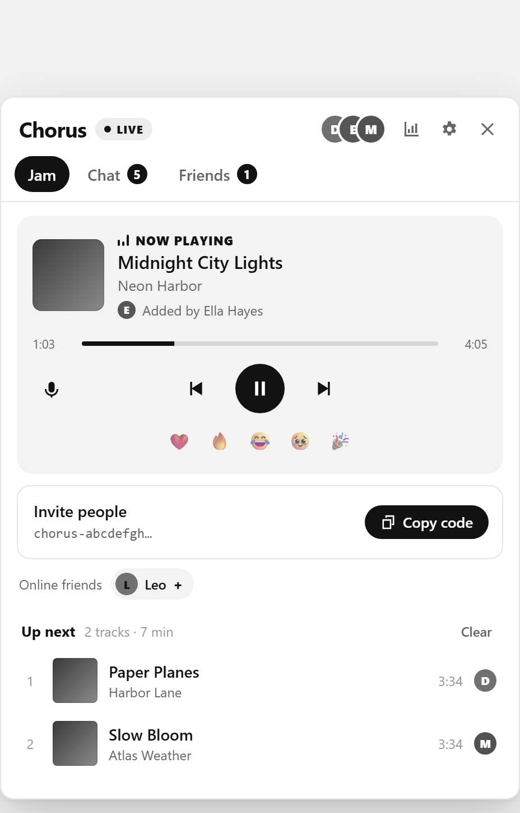
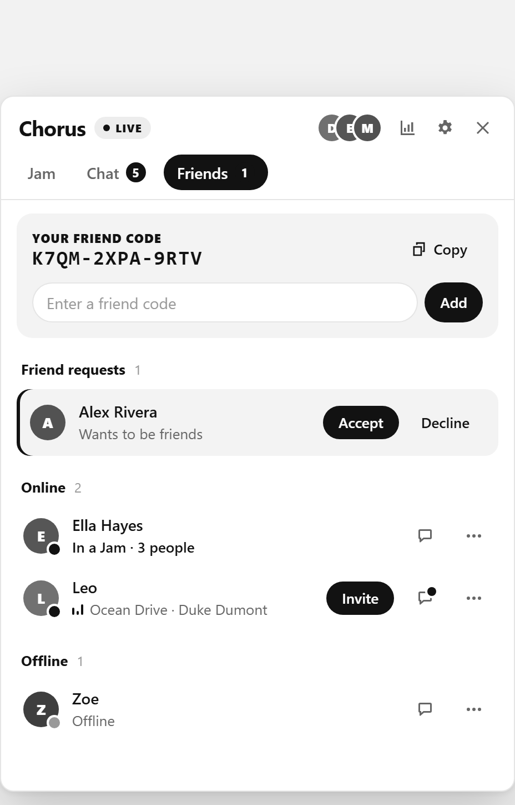
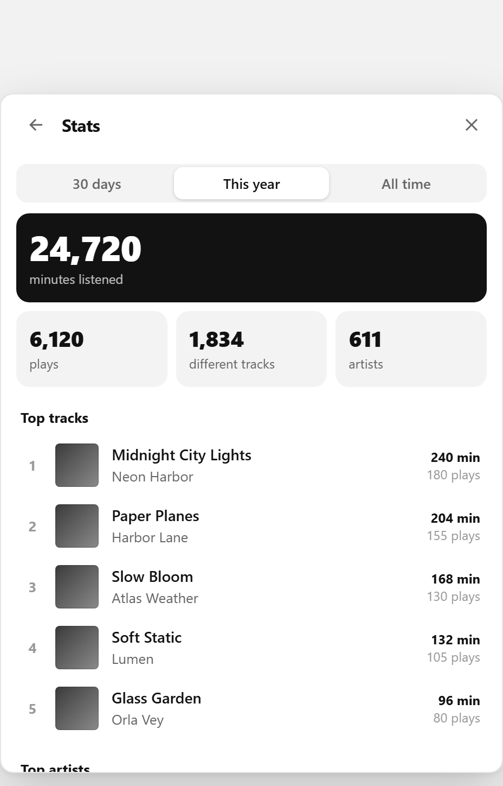

  

<h1 align="center">Chorus for SoundCloud</h1>

  SoundCloud'u arkadaşlarınla aynı anda, tam senkron dinle. 
  Ortak sıra · arkadaşlar · uçtan uca şifreli sohbet · senkron şarkı sözleri · yıllık özet

  <a href="README.md">English</a> ·
  <a href="#kurulum">Kurulum</a> ·
  <a href="#nasıl-çalışır">Nasıl çalışır</a> ·
  <a href="PRIVACY.md">Gizlilik</a> ·
  <a href="SECURITY.md">Güvenlik</a>

  
  
  

## Özellikler

**Birlikte dinle**
- **Jam.** Bir Jam başlat ve davet kodunu paylaş. Herkes aynı şarkıyı aynı anda dinler. Saat senkronu ve hafif hız düzeltmesi sayesinde fark birkaç milisaniyede kalır.
- **Ortak sıra.** Herhangi bir `•••` menüsünden şarkı ya da çalma listesi ekleyebilirsin. Sırayı sürükleyerek düzenlersin. Sıra azalınca akıllı öneriler devreye girer.
- **Host yetkileri.** Diğerlerinin neler yapabileceğine host karar verir. Varsayılanda misafirler şarkı ekleyebilir, çalmayı ise yalnızca host yönetir. Host her kişiye ayrı ayrı **Sıra** ya da **Kontrol** yetkisi verebilir. Ayrıca kişileri çıkarabilir, hostluğu devredebilir, Jam'i kilitleyebilir ve yeni davet kodu oluşturabilir.
- **Tepkiler.** Çalan şarkıya ❤️ 🔥 😂 🥹 🎉 gönderebilirsin.

**Arkadaşlar ve sohbet**
- **Arkadaş kodu.** Herkesin `K7QM-2XPA-9RTV` gibi kısa bir kodu vardır. Arkadaşını bu kodla ya da doğrudan Jam'den ekleyebilirsin. Aynı ağda olmanız gerekmez.
- **Durum.** Hangi arkadaşının çevrimiçi olduğunu, ne dinlediğini ve kimin Jam'de olduğunu görürsün. Tek tıkla katılabilir ya da onları kendi Jam'ine çağırabilirsin.
- **Mesajlar.** Jam'deki herkesle ya da arkadaşlarınla birebir yazışabilirsin. Tüm mesajlar uçtan uca şifrelidir.

**Jam dışında da senin için**
- **Senkron sözler.** Sözler şarkıyla birlikte satır satır akar. Bir satıra tıklayınca şarkı oraya sarar. Kaynak: [LRCLIB](https://lrclib.net).
- **İstatistikler.** Son 30 gün, bu yıl ve tüm zamanlar için en çok dinlediğin şarkıları, sanatçıları ve türleri, toplam dakikanı ve hangi saatlerde dinlediğini görürsün. Veriler yalnızca senin cihazında saklanır. İstersen arkadaşlarına bir özet açabilirsin.
- **Yıllık özet.** Yıl bitince dakikaların, en çok dinlediğin sanatçı ve şarkılar ve tarzınla hazırlanan özetin açılıp paylaşılmaya hazır olur.
- **Uyku zamanlayıcısı.** Müzik 15, 30 ya da 60 dakika sonra veya şarkı bitince durur.
- **Türkçe ve İngilizce.** Chorus tarayıcının dilini kullanır. Dili Ayarlar'dan değiştirebilirsin.

## Kurulum

Chorus; Chrome, Edge, Brave, Opera ve diğer Chromium tabanlı tarayıcılarda (sürüm 116 ve üzeri) çalışır.

1. [Releases](../../releases) sayfasından en yeni `chorus-*.zip` dosyasını indirip zipten çıkar. İstersen bu repoyu klonlayabilirsin.
2. `chrome://extensions` adresini aç (Edge'de `edge://extensions`) ve **Geliştirici modu**'nu aç.
3. **Paketlenmemiş öğe yükle**'ye bas ve `extension` klasörünü seç.
4. [soundcloud.com](https://soundcloud.com)'u aç ya da yenile. Chorus düğmesi çalma çubuğunda ve üst menüde görünür.

Birlikte dinlemek isteyen herkesin Chorus'u kurması gerekir.

## Nasıl çalışır

Chorus'un kendine ait bir sunucusu yoktur. Kullanıcılar küçük şifreli mesajlarını herkese açık MQTT aracıları üzerinden TLS WebSocket ile iletir. Ana aracı `broker.emqx.io`, yedekleri `broker.hivemq.com` ve `test.mosquitto.org`'dur.

- **Kimlik:** Her kurulum biri imza, biri anahtar değişimi için iki P‑256 anahtarı üretir. Kimliğin bu anahtarların özetidir, bu yüzden başkası senin kimliğine bürünemez.
- **Jam trafiği:** Davet kodundan türetilen anahtarla AES‑256‑GCM ile şifrelenir. Her mesaj ayrıca imzalanır, böylece kimse host'un ya da başka bir üyenin yerine geçemez.
- **Birebir mesajlar, davetler ve arkadaşlık istekleri:** Alıcıya özel, tek kullanımlık ECDH anahtarıyla şifrelenir ve gönderen tarafından imzalanır. Tekrar saldırılarına karşı her mesaj bir nonce ve zaman damgası taşır.
- **Durum bilgisi:** Yalnızca arkadaşlarının bildiği bir anahtarla şifrelenir. Birini arkadaşlıktan çıkarınca bu anahtar yenilenir.
- **Jam'den çıkarma:** Biri Jam'den çıkarıldığında host Jam anahtarını yeniler ve eski davet kodu çalışmaz hale gelir.

Aracı sunucular yalnızca şifreli veriyi, rastgele görünen konu adlarını ve bağlantı IP'lerini görür. Ayrıntılar [SECURITY.md](SECURITY.md) dosyasında.

## Sorumluluk reddi

Chorus bağımsız, açık kaynaklı bir projedir. SoundCloud ile bir bağı yoktur ve SoundCloud tarafından onaylanmamış ya da desteklenmemiştir. SoundCloud, sahibinin ticari markasıdır.

## Lisans

[MIT](LICENSE)
